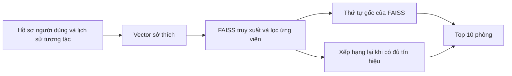

# Thực nghiệm gợi ý phòng trọ dựa trên lịch sử tương tác

Tài liệu này tổng hợp quy trình và số liệu cho mục **1.4.3. AI gợi ý phòng** của báo cáo Webtro. Thí nghiệm đánh giá bốn cấu hình trên cùng danh sách phòng do FAISS truy xuất. **FAISS + CatBoost** đạt NDCG@10 cao nhất trên tập xác thực và được chọn để đánh giá tiếp. Trên tập kiểm thử giữ riêng, **FAISS** đạt NDCG@10 và Recall@10 cao hơn, đồng thời xử lý nhanh hơn. [Bảng đối chứng](storage/experiments/comparison/comparison.csv) · [Kết quả chi tiết](storage/experiments/comparison/comparison.json)

## 1.4.3.1. Bài toán và phạm vi gợi ý phòng

Module nhận hồ sơ người dùng, lịch sử xem và yêu thích, cùng danh mục phòng. Mục tiêu là trả về tối đa **10 phòng** phù hợp. Thực nghiệm được thực hiện trên module AI độc lập. Demo của module hiện gọi FAISS và LightGBM. Website chính có luồng gợi ý riêng trong Spring Boot. [Luồng gợi ý demo](app/reranker/ranker.py) · [Tài liệu module](README.md)

## 1.4.3.2. Dữ liệu và xây dựng hồ sơ sở thích

| Dữ liệu | Số lượng | Vai trò |
|---|---:|---|
| [Danh mục phòng](data/rooms.json) | 12.958 | Xây chỉ mục và tạo đặc trưng về giá, diện tích, vị trí, loại phòng và tiện ích |
| [Người dùng mô phỏng](data/users.json) | 200 | Cung cấp hồ sơ và nhóm mẫu theo người dùng |
| [Sự kiện tương tác mô phỏng](data/view_history.json) | 11.812 | Gồm 11.246 lượt xem và 566 lượt yêu thích, dùng để tạo hồ sơ sở thích và nhãn |

Hệ thống tổng hợp lịch sử theo cặp người dùng–phòng. Lượt xem được gộp theo phiên. Trọng số hành vi được đặt sẵn, sau đó giảm theo thời gian khi tính vector hồ sơ tìm kiếm. Nhãn liên quan được dùng riêng trong huấn luyện xếp hạng.

| Hành vi với một phòng | Trọng số hồ sơ | Nhãn liên quan |
|---|---:|---:|
| Xem 1–2 phiên | 1 | 1 |
| Xem từ 3 phiên | 2 | 2 |
| Đang đánh dấu yêu thích | 4 | 3 |
| Phòng được lấy làm mẫu âm | | 0 |

Mỗi phòng được biểu diễn bằng **vector 65 chiều** để FAISS truy xuất. Sau truy xuất, mỗi cặp người dùng–phòng ứng viên có **32 đặc trưng** dùng chung cho ba mô hình xếp hạng, gồm điểm FAISS, độ khớp với khu vực, giá, diện tích, loại phòng và tiện ích quan tâm. [Trọng số và nhãn](app/recommender/interactions.py) · [Hồ sơ sở thích](app/recommender/profile.py) · [Đặc trưng xếp hạng](app/reranker/features.py)

## 1.4.3.3. Các phương pháp và mô hình ứng viên

| Cấu hình | Cách tạo thứ tự gợi ý |
|---|---|
| **FAISS** | Lấy thứ tự theo độ tương đồng của phòng với vector hồ sơ. Đây là mốc đối chứng. |
| **FAISS + LightGBM** | Dùng `LGBMRanker` với mục tiêu `lambdarank` để sắp xếp lại ứng viên. |
| **FAISS + XGBoost** | Dùng `XGBRanker` với mục tiêu `rank:ndcg` và lấy cặp theo chế độ `mean` để học từ nhãn liên quan nhiều mức. |
| **FAISS + CatBoost** | Dùng `CatBoostRanker` với `YetiRank` ở chế độ NDCG, tập trung vào 10 vị trí đầu. |

Các mô hình học thứ tự ưu tiên trong nhóm phòng của từng người dùng. Cấu hình xếp hạng được đối chiếu với tài liệu chính thức của các thư viện và nghiên cứu về YetiRank. [LightGBM](https://lightgbm.readthedocs.io/en/stable/pythonapi/lightgbm.LGBMRanker.html) · [XGBoost Learning to Rank](https://xgboost.readthedocs.io/en/stable/tutorials/learning_to_rank.html) · [CatBoost Ranking](https://catboost.ai/docs/en/concepts/loss-functions-ranking) · [Lyzhin và cộng sự, ICML 2023](https://proceedings.mlr.press/v202/lyzhin23a.html)

## 1.4.3.4. Thiết kế thực nghiệm và huấn luyện

1. **Chia người dùng theo tỷ lệ 70/15/15**, gồm 140 người để huấn luyện, 30 để xác thực và 30 để kiểm thử. Cả ba mô hình dùng cùng danh sách người dùng và seed `42`.
2. **Chia lịch sử từng người theo thời gian ở cấp phòng.** Khoảng 80% phòng có tương tác sớm hơn dùng để dựng hồ sơ sở thích. Các phòng có tương tác muộn hơn dùng làm phòng mục tiêu. Các sự kiện của cùng một phòng được giữ chung trong một phần.
3. **Tạo mẫu huấn luyện và xác thực cho ranker.** Giữ các phòng mục tiêu làm mẫu dương và lấy tối đa bốn ứng viên FAISS làm mẫu âm cho mỗi mẫu dương. Mỗi mô hình nhận **3.500 mẫu huấn luyện từ 133 người dùng đủ điều kiện** và **625 mẫu xác thực từ 28 người dùng đủ điều kiện**.
4. **Huấn luyện ba ranker** với tốc độ học 0,05, tối đa 400 vòng và dừng sớm sau 30 vòng xác thực liên tiếp thiếu cải thiện. Dùng NDCG@10 trên mẫu xác thực có bổ sung phòng mục tiêu để chọn vòng huấn luyện.
5. **Chạy đối chứng toàn quy trình.** Mỗi người dùng có một danh sách tối đa 80 ứng viên lấy từ FAISS, sau đó lọc phòng đã tương tác hoặc hết chỗ. Cả bốn cấu hình dùng chung danh sách này. Hai người dùng xác thực có dưới 5 tín hiệu giữ thứ tự FAISS trong cả bốn cấu hình. Chọn cấu hình theo NDCG@10 trên tập xác thực, rồi đánh giá cấu hình đó cùng mốc FAISS trên tập kiểm thử giữ riêng.

Chỉ mục dùng trong đối chứng là `IndexIVFFlat` với 455 cụm và `nprobe = 16`. Kết quả được lấy trung bình theo người dùng. **NDCG@10** xét thứ tự và mức liên quan trong 10 vị trí đầu. **Recall@10** đo tỷ lệ phòng mục tiêu xuất hiện trong 10 gợi ý. **Candidate Recall@80** đo tỷ lệ phòng mục tiêu lọt vào danh sách ứng viên chung sau khi lọc. Thời gian trung bình đo xử lý trong bộ nhớ trên máy chạy thử, gồm dựng hồ sơ, truy xuất và xếp hạng khi áp dụng. [Tạo dữ liệu huấn luyện](app/reranker/dataset.py) · [Script đối chứng](scripts/compare_rankers.py)

### Kết quả huấn luyện riêng của các ranker

| Mô hình | NDCG@10 vòng đầu | NDCG@10 tốt nhất | Vòng tốt nhất |
|---|---:|---:|---:|
| [LightGBM 4.7.0](storage/experiments/lightgbm/training_meta.json) | 0,5757 | 0,7609 | 10 |
| [XGBoost 3.2.0](storage/experiments/xgboost/training_meta.json) | 0,6643 | 0,7842 | 8 |
| [CatBoost 1.2.10](storage/experiments/catboost/training_meta.json) | 0,6425 | 0,7670 | 111 |

Bảng này cho biết vòng huấn luyện được chọn của từng mô hình. Hai bảng dưới đây đánh giá Top 10 từ các phòng FAISS thực sự thu hồi, với toàn bộ phòng mục tiêu của mỗi người làm căn cứ tính điểm.

## 1.4.3.5. Kết quả so sánh trên tập xác thực

| Cấu hình · 30 người dùng | NDCG@10 ↑ | Recall@10 ↑ | Thời gian trung bình ↓ |
|---|---:|---:|---:|
| FAISS | 0,004913 | 1,31% | 0,72 ms |
| FAISS + LightGBM | 0,003951 | 0,48% | 1,74 ms |
| FAISS + XGBoost | 0,004936 | 1,31% | 2,66 ms |
| **FAISS + CatBoost** | **0,014174** | **2,70%** | 2,44 ms |

**FAISS + CatBoost** được chọn vì có NDCG@10 cao nhất trên tập xác thực. Candidate Recall@80 của FAISS là **8,93%**. Chỉ **7/30 người dùng** có ít nhất một phòng mục tiêu trong danh sách ứng viên. [Số liệu xác thực](storage/experiments/comparison/comparison.json)

## 1.4.3.6. Lựa chọn mô hình và đánh giá trên tập kiểm thử

| Cấu hình · 30 người dùng giữ riêng | NDCG@10 ↑ | Recall@10 ↑ | Thời gian trung bình ↓ |
|---|---:|---:|---:|
| **FAISS** | **0,007961** | **2,56%** | **0,91 ms** |
| FAISS + CatBoost | 0,007510 | 2,04% | 2,93 ms |

Trên tập kiểm thử, FAISS có NDCG@10 cao hơn **0,000451** và Recall@10 cao hơn **0,52 điểm phần trăm** so với cấu hình được chọn. Candidate Recall@80 đạt **9,48%** và **9/30 người dùng** có ít nhất một phòng mục tiêu trong danh sách ứng viên. Với quy mô và dữ liệu mô phỏng hiện tại, kết quả cho thấy lợi thế của CatBoost ở bước lựa chọn cần được kiểm chứng thêm. [Số liệu kiểm thử](storage/experiments/comparison/comparison.json)

### Minh chứng cho quyết định giữ LightGBM trong demo

Thực nghiệm bổ sung so sánh trực tiếp LightGBM, CatBoost và mốc FAISS qua **5 fold theo người dùng** trên cùng bộ 200 hồ sơ mô phỏng. Mỗi fold phân bổ 128 người vào tập huấn luyện, 32 người vào tập xác thực và 40 người vào tập đánh giá. Hai tập đầu chỉ sinh mẫu từ hồ sơ đủ điều kiện. Mỗi người được đánh giá đúng một lần bằng mô hình huấn luyện trên nhóm người dùng khác. Ba cấu hình nhận cùng danh sách ứng viên thực tế từ FAISS, và mỗi người có trọng số bằng nhau khi tính điểm trung bình. [Mã đối chứng 5 fold](scripts/compare_rankers_cv.py) · [Số liệu từng fold](storage/experiments/ranker_cross_validation.json)

| Cấu hình · 200 người dùng mô phỏng | NDCG@10 ↑ | Recall@10 ↑ | Thời gian trung bình ↓ |
|---|---:|---:|---:|
| **FAISS** | **0,011847** | **2,09%** | **0,84 ms** |
| FAISS + LightGBM | 0,008012 | 1,42% | 2,03 ms |
| FAISS + CatBoost | 0,006597 | 0,66% | 2,83 ms |

LightGBM đạt NDCG@10 và Recall@10 trung bình cao hơn CatBoost, với thời gian xử lý trung bình thấp hơn khoảng **0,79 ms**. So riêng từng fold theo NDCG@10, mỗi ranker dẫn trước ở hai fold và hai ranker hòa ở một fold. Vì vậy, nhóm giữ LightGBM cho demo hiện tại. FAISS đạt điểm trung bình cao nhất trong thí nghiệm và Candidate Recall@80 là **9,90%**. Đây là bằng chứng trên bộ tương tác mô phỏng, trong phạm vi cấu hình đã chạy. [Kết quả tổng hợp](storage/experiments/ranker_cross_validation.json)

## 1.4.3.7. Kiến trúc module và hướng cải thiện



Tầng xếp hạng chỉ có thể sắp xếp lại các phòng xuất hiện trong danh sách ứng viên. Với Candidate Recall@80 khoảng **9%** trên cả hai tập, hướng cải thiện trước tiên là thử tăng số ứng viên hoặc điều chỉnh cấu hình truy xuất trên tập xác thực và đo lại độ thu hồi. Một đợt kiểm thử mới có thể dùng để kiểm chứng cấu hình sau khi điều chỉnh.

## Tái lập thí nghiệm và lấy số liệu

Từ thư mục `AI_Recommendation`, chạy các lệnh dưới đây trong bản checkout chưa có các thư mục kết quả tương ứng. [Hướng dẫn thực nghiệm](README.md)

```bash
python -m pip install -r requirements-experiments.txt
python scripts/train_xgboost.py
python scripts/train_catboost.py --split-from storage/experiments/xgboost/training_meta.json
python scripts/train_lightgbm_experiment.py --split-from storage/experiments/xgboost/training_meta.json
python scripts/compare_rankers.py
```

Để chạy lại phép đối chứng bằng ba mô hình đã lưu, dùng một thư mục đầu ra mới.

```bash
python scripts/compare_rankers.py --output-dir storage/experiments/comparison_rerun
```

Để tái lập minh chứng đối chứng 5 fold, chạy lệnh sau. Các mô hình huấn luyện theo fold chỉ dùng trong lúc tính điểm.

```bash
python scripts/compare_rankers_cv.py --output storage/experiments/ranker_cross_validation_rerun.json
```

[Bảng CSV để đưa vào báo cáo](storage/experiments/comparison/comparison.csv) · [JSON gồm chỉ số chi tiết và cách chia người dùng](storage/experiments/comparison/comparison.json)
