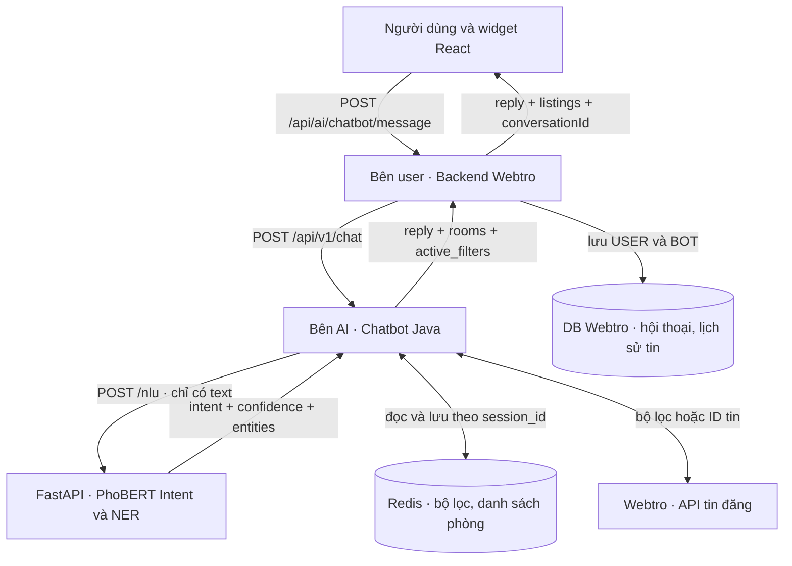

# Báo cáo và ghi chú kỹ thuật về chatbot tìm trọ Webtro

## Tóm tắt

Webtro là chatbot hướng nhiệm vụ. React nhận câu chat và hiển thị kết quả. Backend chính của Webtro kiểm tra quyền, quản lý hội thoại và lịch sử. Module chatbot điều phối lượt chat, gọi hai mô hình PhoBERT để hiểu câu, dùng Redis để giữ ngữ cảnh và tìm phòng từ tin đăng của Webtro. Câu trả lời có thể được tạo từ mẫu Java hoặc Gemini.

Kiến trúc này **khả thi cho đồ án và bản dùng thử**. Hai model đang dùng là `intent-focused-v1` và `ner-focused-v1`. Trên bộ 500 câu tổng hợp, Intent đạt **92,17% Accuracy** trên 460 câu có một intent và NER đạt **86,81% strict span-F1** trên cả 500 câu. Trên GOLD 28 mẫu thật, hai chỉ số tương ứng là **96,43%** và **91,43%**. Tỷ lệ hoàn thành yêu cầu của cả chatbot trên tập hội thoại đại diện vẫn cần một phép đo riêng.

**Cách đọc đề xuất.** Mục 1–5 lần theo câu chat từ React đến kết quả. Mục 6 đi từ dữ liệu train đến một lần cập nhật trọng số thật. Mục 7 giải thích các con số và cách xây tập chuẩn. Các mục cuối tổng hợp nghiên cứu và thiết kế mở rộng cho câu nhiều yêu cầu.

## 1. Bản đồ hệ thống và ba API dễ nhầm

Trong tài liệu này, **bên user** là backend chính Webtro (`backend_webtro`). **Bên AI** là module chatbot Java cùng FastAPI NLU mà nó gọi. **Widget** là React bên frontend.



| API | Ai gọi và gọi vào đâu? | Đầu vào và đầu ra chính |
| --- | --- | --- |
| `POST /api/ai/chatbot/message` | React gọi `ChatbotController.sendMessage()` ở bên user | `message`, `sessionId`, `conversationId`, có thể có `resetContext`. Trả `reply`, `listings`, ID hội thoại và dữ liệu hiển thị. |
| `POST /api/v1/chat` | `AiChatbotClient.chat()` của backend Webtro gọi `ChatController.chat()` ở bên AI | `message`, `session_id`, có thể có `user_id`. Trả `reply`, `rooms`, `intent`, `active_filters`, `meta`. |
| `POST /nlu` | `LocalNluServiceImpl.parse()` của chatbot Java gọi `nlu()` ở FastAPI | `{"text":"..."}`. Trả `intent`, `confidence`, `entities`. |

`/api/ai/chatbot` là đường dẫn gốc nhóm API ở bên user. Endpoint gửi tin nhắn có hậu tố `/message`. Cùng nhóm này còn có endpoint xem các hội thoại và lịch sử. `/api/v1/chat` là endpoint xử lý lượt chat ở module chatbot. Spring lấy URL từ annotation của controller. Tên `ChatbotController` và `ChatController` là tên class Java.

[Widget React](../../../frontend_webtro/src/components/chatbot/ChatbotWidget.jsx#L76) · [Controller bên user](../../../backend_webtro/src/main/java/com/webtro/modules/ai/controller/ChatbotController.java#L34) · [Controller bên AI](src/main/java/com/roomfinder/chat/controller/ChatController.java#L15) · [Docker Compose](../../../docker-compose.yml)

## 2. Bên user nhận tin nhắn và giao việc cho bên AI

Ta dùng một phiên ví dụ với ba câu: **“Tìm phòng dưới 3 triệu ở Cầu Giấy”**, **“rẻ hơn nữa đi”**, rồi **“so sánh phòng 1 với phòng 2”**. Các ID trong ví dụ là ID minh họa hoặc ID của kịch bản kiểm thử. Phần đầu ra PhoBERT ở mục 4 được chạy trực tiếp bằng trọng số hiện có. Đường đi qua Redis, DB và UI dưới đây được lần theo mã nguồn và kịch bản mẫu. Lúc kiểm tra, Docker daemon không kết nối được để chạy lại toàn hệ thống. [Kịch bản kiểm thử](TEST_CASES_CHATBOT.md#L76)

### 2.1. React gửi dữ liệu gì?

Hàm `send()` lấy nội dung ô chat, bỏ khoảng trắng hai đầu và kiểm tra trạng thái `loading`. Widget thêm tin nhắn `USER` vào màn hình ngay, rồi mới đợi HTTP. `getChatSessionId()` lấy mã phiên từ `sessionStorage` hoặc tạo mã mới. Cuộc trò chuyện mới có thể gửi:

```json
{
  "conversationId": null,
  "sessionId": "session-A",
  "message": "Tìm phòng dưới 3 triệu ở Cầu Giấy",
  "resetContext": true
}
```

`sessionId` nhận diện phiên. `conversationId` là ID bản ghi hội thoại bên user và được React cập nhật từ response. `userId` do backend lấy từ thông tin đăng nhập. Khách có `userId = null` và cần `sessionId`. `resetContext` được gửi khi widget đang bắt đầu lại. [Hàm `send()`](../../../frontend_webtro/src/components/chatbot/ChatbotWidget.jsx#L76) · [Cách giữ mã phiên](../../../frontend_webtro/src/utils/chatSession.js#L31)

### 2.2. `resolveConversation()` chọn hội thoại nào?

Hàm này nhận `request`, `userId`, `sessionId` và cờ `reset`. Thứ tự các nhánh quan trọng:

1. **Request có `conversationId`.** `findById()` tìm bản ghi theo ID và lọc hội thoại đã xóa mềm. Nếu tìm thấy, `assertOwnership()` kiểm tra quyền. Hội thoại đã gắn tài khoản thì đối chiếu `userId`. Hội thoại khách thì đối chiếu `sessionId`. Nếu khách vừa đăng nhập trong cùng phiên, `claimGuestConversation()` có thể gắn bản ghi đó vào tài khoản. Với `reset = true`, nhánh theo ID đặt lại bộ đếm hỏi thêm.
2. **Request chưa có `conversationId` nhưng có `sessionId`.** `findBySessionIdAndDeletedAtIsNull()` tìm theo mã phiên. Hội thoại của khách hoặc cùng tài khoản được dùng tiếp. Nếu mã phiên đang gắn với tài khoản khác, `releaseSessionId()` đổi mã của bản ghi cũ sang UUID khác và `saveAndFlush()` để giải phóng khóa duy nhất trong DB. Khi tích hợp AI bật, hàm cũng yêu cầu xóa ngữ cảnh AI của mã phiên đó. Sau đó backend tạo hội thoại cho người đang gửi.
3. **Cần hội thoại mới.** `createConversation()` tạo bản ghi `ACTIVE` với bộ lọc và các bộ đếm ban đầu. Ví dụ DB trả lại `conversationId = 101`.

Nếu React gửi thẳng một ID sai hoặc đã xóa, code báo lỗi theo nhánh ID. Nếu ID thuộc tài khoản khác, bước kiểm tra quyền báo `FORBIDDEN`. [`resolveConversation()`, `releaseSessionId()` và `assertOwnership()`](../../../backend_webtro/src/main/java/com/webtro/modules/ai/service/impl/ChatbotServiceImpl.java#L408)

Đây là nhánh đầu trong code, áp dụng khi trang web gửi kèm ID hội thoại:

```java
if (request.getConversationId() != null) {
    ChatbotConversation conv = conversationRepository.findById(request.getConversationId())
            .filter(c -> c.getDeletedAt() == null)
            .orElseThrow(() -> new ResourceNotFoundException(
                    ErrorCode.CHATBOT_CONVERSATION_NOT_FOUND));
    assertOwnership(conv, userId, sessionId);
    claimGuestConversation(conv, userId);
    if (reset) {
        conv.setClarifyTurnCount(0);
    }
    return conv;
}
```

### 2.3. `handleMessage()` làm gì trước khi gọi AI?

`handleMessage()` là hàm điều phối **bên user**. Nó kiểm tra tính năng đã bật, làm sạch HTML và khoảng trắng, kiểm tra độ dài, giới hạn tần suất theo tài khoản hoặc phiên, rồi gọi `resolveConversation()`. Sau đó `engine.interpret(...)` dùng luật Java để lấy dữ liệu định tuyến. Ví dụ, câu hỏi định nghĩa như **“cọc là gì?”** có thể dùng câu trả lời trong từ điển. Những câu tìm phòng thông thường đi sang module AI khi tích hợp được bật.

Đoạn trích lược phần kiểm tra và xử lý lỗi:

```java
ChatbotConversation conv = resolveConversation(request, userId, sessionId, reset);

// Khi lượt này được định tuyến sang AI
if (reset) {
    aiChatbot.reset(conv.getSessionId());
}
ai = aiChatbot.chat(conv.getSessionId(), sanitized, userId);
```

Điểm cần theo dõi khi debug là `conv.getSessionId()`. Backend chuyển **mã phiên đã gắn với bản ghi hội thoại**, kèm câu đã làm sạch, sang bên AI. Cờ `resetContext` được bên user xử lý bằng lời gọi `POST /api/v1/chat/reset` riêng. Lời gọi chat có dạng:

```json
{
  "session_id": "session-A",
  "message": "Tìm phòng dưới 3 triệu ở Cầu Giấy"
}
```

Với người dùng đăng nhập, client có thể gửi `user_id` để hỗ trợ cá nhân hóa. Khi module AI lỗi hoặc timeout trong nhánh tìm phòng, backend hiển thị lời báo sự cố. Chế độ tìm phòng theo luật của backend được dùng khi chủ động tắt tích hợp chatbot AI. Với nhóm chào hỏi, FAQ và một số câu mẫu, backend còn có thể ưu tiên phản hồi theo luật dựa trên kết quả AI. [`handleMessage()` và định tuyến](../../../backend_webtro/src/main/java/com/webtro/modules/ai/service/impl/ChatbotServiceImpl.java#L97) · [`AiChatbotClient.chat()`](../../../backend_webtro/src/main/java/com/webtro/modules/ai/engine/AiChatbotClient.java#L69)

## 3. Bên AI nhận request và nạp trạng thái hội thoại

### 3.1. `ChatController` mở ba endpoint

| Hàm | Endpoint | Ý nghĩa |
| --- | --- | --- |
| `chat()` | `POST /api/v1/chat` | Nhận JSON thành `ChatRequest`, kiểm tra `message` có nội dung, gọi `orchestrator.handle(request)`. |
| `reset()` | `POST /api/v1/chat/reset` | Đọc `session_id` hoặc `sessionId`, rồi gọi `contextService.delete(...)` để xóa dữ liệu phiên trong Redis. |
| `health()` | `GET /api/v1/chat/health` | Trả `{"status":"UP"}` khi controller trả lời được. FastAPI có `/ready` để kiểm tra model sẵn sàng. |

```java
@PostMapping
public ChatResponse chat(@Valid @RequestBody ChatRequest request) {
    return orchestrator.handle(request);
}
```

`@RequestBody` dùng JSON để tạo object Java. `@Valid` chạy ràng buộc trên DTO, gồm `@NotBlank` cho `message`. Cấu hình Jackson `SNAKE_CASE` ánh xạ `session_id` thành `sessionId` trong Java. [`ChatController`](src/main/java/com/roomfinder/chat/controller/ChatController.java#L27) · [`ChatRequest`](src/main/java/com/roomfinder/chat/dto/ChatRequest.java) · [Cấu hình JSON](src/main/resources/application.yml#L42)

### 3.2. `handle()` và `ContextService.load()` giữ hai nguồn dữ liệu

```java
String message = req.getMessage();
ChatContext ctx = contextService.load(sessionId);
if (req.getUserId() != null) ctx.setUserId(req.getUserId());

NluResult nlu = nluService.parse(message);
```

Nếu request bỏ trống mã phiên, `handle()` tạo mã dạng `s-<UUID>`. `load()` đọc Redis ở khóa `chat:session:session-A`. Nếu có JSON thì Jackson chuyển thành `ChatContext`. Nếu chưa có khóa hoặc đọc lỗi thì trả `ChatContext.empty(sessionId)`. Ở lượt thứ hai của ví dụ, hai biến có nhiệm vụ khác nhau:

```text
message — câu vừa gửi
  "rẻ hơn nữa đi"

ctx — phiên đã lưu sau lượt trước
  activeFilters = { location: "Cầu Giấy", priceMax: 3000000 }
  lastResultIds = [29, 37, 30, 38, 31]
  pendingSlot   = null
```

`lastResultIds` giữ thứ tự bot đã gợi ý. `pendingSlot` thể hiện bot đang chờ thêm thông tin. `turnCount` đếm lượt và `updatedAt` ghi thời điểm cập nhật. `apply()` sửa object trong bộ nhớ Java. `save()` cập nhật thời điểm và ghi lại Redis với TTL mặc định **30 phút**. `delete()` xóa khóa phiên khi reset. [Đầu hàm `handle()`](src/main/java/com/roomfinder/chat/service/ChatOrchestrator.java#L107) · [Các trường của `ChatContext`](src/main/java/com/roomfinder/chat/model/ChatContext.java#L20) · [Đọc và ghi Redis](src/main/java/com/roomfinder/chat/service/ContextService.java#L36)

### 3.3. Interface `NluService`, implementation và kiểu trả về

```java
public interface NluService {
    NluResult parse(String message);
}

@Primary
public class LocalNluServiceImpl implements NluService {
    // Triển khai parse() bằng cách gọi FastAPI.
}
```

`implements NluService` nghĩa là class thực hiện hợp đồng của interface. `NluResult` là object **trả về**, chứa `intent`, `confidence` và `entities` kiểu `Filters`. `ChatOrchestrator` khai báo dependency kiểu `NluService`. Spring ưu tiên truyền `LocalNluServiceImpl` vì có `@Primary`. Repo có ba implementation gồm **LocalNluServiceImpl** chạy PhoBERT thông qua FastAPI, **LlmNluServiceImpl** phân tích bằng LLM và **RuleBasedNluService** dùng luật Java. Khi NLU local bị tắt hoặc lời gọi thất bại, chuỗi dự phòng là **LLM → luật**. [Interface `NluService`](src/main/java/com/roomfinder/chat/service/NluService.java) · [Model `NluResult`](src/main/java/com/roomfinder/chat/model/NluResult.java) · [Khai báo `@Primary` và fallback](src/main/java/com/roomfinder/chat/service/LocalNluServiceImpl.java#L39) · [Fallback của LLM](src/main/java/com/roomfinder/chat/service/LlmNluServiceImpl.java#L67)

## 4. FastAPI và PhoBERT hiểu câu như thế nào?

### 4.1. NLU, Intent, NER và chuẩn hóa

**NLU** là tầng hiểu ngôn ngữ tự nhiên. Tầng này dùng hai model PhoBERT đã fine-tune riêng.

| Khái niệm | Câu hỏi được giải | Ví dụ đầu ra |
| --- | --- | --- |
| **Intent classification** | Người dùng muốn làm gì với cả câu? | `search_room`, `compare_rooms`. |
| **NER** | Đoạn nào mang thông tin và thuộc loại gì? | `3 triệu` → `PRICE_MAX`, `Cầu Giấy` → `LOCATION`. |
| **Chuẩn hóa dữ liệu** | Đoạn chữ đó trở thành tham số nào trong code? | `3 triệu` → `priceMax = 3000000` ở Java. |

`LocalNluServiceImpl.parse()` đóng gói **câu mới** thành `{"text":"rẻ hơn nữa đi"}`, gửi `POST /nlu` rồi đọc JSON vào `NluServiceResponse`. Ngữ cảnh nằm trong biến `ctx` ở Java. Hàm Python chạy hai model với cùng trường `text`.

```python
@app.post("/nlu", response_model=NluResponse)
def nlu(req: NluRequest) -> NluResponse:
    ensure_ready()
    text = req.text.strip()
    if not text:
        return NluResponse(intent="out_of_scope", confidence=1.0, entities=[])
    intent, confidence = classify_intent(text)
    entities = extract_entities(text)
    return NluResponse(intent=intent, confidence=confidence, entities=entities)
```

`@app.post` nối URL với hàm. `NluRequest` mô tả body có trường `text` kiểu chuỗi. `ensure_ready()` trả HTTP 503 khi model chưa sẵn sàng. `NluResponse` gom nhãn cả câu và danh sách đoạn thực thể thành JSON. Kết quả của Intent và NER gặp nhau ở dòng trả về.

### 4.2. `lifespan()` chạy khi FastAPI khởi động

`nlu-service/app.py` tạo ứng dụng bằng `FastAPI(..., lifespan=lifespan)`. Trước `yield`, code nạp Intent từ `ml/cmp-runs/intent-focused-v1/model` và NER từ `ml/cmp-runs/ner-focused-v1/model`, kiểm tra cấu hình mã hóa, tạo encoder và thực hiện warm-up. Hai model đặt ở chế độ `.eval()` và được giữ trong dictionary `_M` để dùng lại cho các request. Đoạn khởi tạo cũng nạp model embedding cho `/embed`. Khi service đóng, `_M.clear()` giải phóng các tham chiếu đã giữ.

```python
# Trích các dòng chính ở phần khởi tạo trong lifespan()
_M["intent_model"] = AutoModelForSequenceClassification.from_pretrained(INTENT_DIR).eval()
_M["ner_model"] = AutoModelForTokenClassification.from_pretrained(NER_DIR).eval()
# Sau khi kiểm tra cấu hình
_M["intent_enc"] = PhoBertEncoder.from_pretrained(INTENT_DIR, cache=False)
_M["ner_enc"] = PhoBertEncoder.from_pretrained(NER_DIR, cache=False)
```

| Endpoint | Dùng để xem gì? |
| --- | --- |
| `GET /live` | FastAPI đang phản hồi. |
| `GET /ready` | Tài nguyên đã sẵn sàng để xử lý. Trả 503 khi chưa sẵn sàng. |
| `GET /health` | Chi tiết như đường dẫn model, giới hạn chiều dài và lỗi lúc khởi động nếu có. |
| `POST /embed` | Vector dùng để xếp hạng theo ngữ nghĩa khi luồng tìm kiếm cần. |

[Đoạn khởi động `lifespan()`](nlu-service/app.py#L62) · [Khai báo endpoint và kiểu dữ liệu](nlu-service/app.py#L106)

### 4.3. `classify_intent()`: từ câu chữ đến sáu điểm

Webtro huấn luyện sáu nhãn **`search_room`, `refine_search`, `room_detail`, `compare_rooms`, `book_appointment`, `out_of_scope`**.

Câu **“rẻ hơn nữa đi”** đã chạy qua đúng bộ mã hóa của model Intent trong repo:

```text
VnCoreNLP      rẻ hơn_nữa đi
Token          <s>   rẻ    hơn_nữa   đi   </s>
Token ID        0   1455     1483    57     2
Attention mask  1     1        1     1     1
```

`VnCoreNLP` tách từ tiếng Việt. Tokenizer BPE đổi từ và mảnh từ thành ID trong từ vựng. `attention_mask` đánh dấu vị trí còn hiệu lực, trong ví dụ này cả năm vị trí đều được đọc. PhoBERT chuyển ID thành vector, rồi các lớp Transformer dùng self-attention để token tiếp nhận thông tin từ những token khác trong câu. Đầu phân loại của model Intent lấy vector theo ngữ cảnh của token đầu `<s>`. Vector có **768 chiều** trong model hiện tại và được chiếu thành **6 logits**.

```python
ids, mask = _M["intent_enc"].intent(text, _M["intent_len"])
with torch.no_grad():
    logits = _M["intent_model"](
        input_ids=torch.tensor([ids]),
        attention_mask=torch.tensor([mask]),
    ).logits[0]

probs = torch.softmax(logits, dim=-1)
idx = int(probs.argmax())
return _M["intent_model"].config.id2label[idx], float(probs[idx])
```

`torch.no_grad()` bỏ theo dõi gradient khi suy luận. Tensor logits của batch một câu có shape `[1, 6]`, nên `.logits[0]` lấy đúng hàng điểm của câu đang xử lý. Softmax đưa sáu điểm về các giá trị có tổng bằng 1. `argmax()` lấy chỉ số lớn nhất, còn `id2label` đổi chỉ số sang tên nhãn.

| Index | Intent | Logit đo được | Softmax |
| ---: | --- | ---: | ---: |
| 0 | `search_room` | -1,354 | 0,1105% |
| 1 | **`refine_search`** | **5,447** | **99,3074%** |
| 2 | `room_detail` | -1,084 | 0,1447% |
| 3 | `compare_rooms` | -1,248 | 0,1229% |
| 4 | `book_appointment` | -1,276 | 0,1194% |
| 5 | `out_of_scope` | -0,785 | 0,1951% |

Kết quả `0.9931` là confidence của lựa chọn trên **một câu**. Accuracy cần nhiều câu có đáp án. [Bộ mã hóa Intent](ml/phobert_encoding.py#L85) · [Hàm `classify_intent()`](nlu-service/app.py#L186)

### 4.4. `extract_entities()`: từ nhãn token về đoạn chữ gốc

NER tạo điểm cho từng vị trí token thay vì chỉ lấy biểu diễn của `<s>`. Encoder trả **`ids`, `mask` và `spans`**. Mỗi span cho biết vị trí của từ trong câu gốc. Code chọn nhãn BIO có điểm cao nhất cho mỗi vị trí rồi gọi `decode_bio_offsets(...)` để ghép các nhãn và phục hồi đoạn chữ. **`B-UTILITY`** bắt đầu một tiện ích, **`I-UTILITY`** tiếp tục tiện ích đó, **`O`** là ngoài thực thể. Chi tiết mã hóa và cách train BIO có ở mục 6.

Đầu ra đã chạy trên hai model hiện có, thu gọn và làm tròn:

| Câu chat | Intent | Thực thể NER |
| --- | --- | --- |
| Tìm phòng dưới 3 triệu ở Cầu Giấy | `search_room` · 0.9981 | `phòng`: `ROOM_TYPE` `[4, 9)`, `3 triệu`: `PRICE_MAX` `[15, 22)`, `Cầu Giấy`: `LOCATION` `[25, 33)`. |
| rẻ hơn nữa đi | `refine_search` · 0.9931 | `[]`. Câu chỉ yêu cầu lọc tiếp và chưa đưa mức giá cụ thể. |
| so sánh phòng 1 với phòng 2 | `compare_rooms` · 0.9837 | `phòng 1`: `ROOM_REF` `[8, 15)` và `phòng 2`: `ROOM_REF` `[20, 27)`. |

`[15, 22)` nghĩa là bắt đầu ở ký tự 15 và dừng ngay trước vị trí 22. `text[15:22]` của câu đầu cho `3 triệu`. [`extract_entities()`](nlu-service/app.py#L196) · [Code ghép BIO và offset](ml/nlu_encoding.py#L137)

## 5. Từ đầu ra FastAPI đến thẻ phòng

### 5.1. `toNluResult()` chuyển JSON thành tham số nghiệp vụ

`LocalNluServiceImpl.parse()` nhận JSON vào `NluServiceResponse` và gọi `toNluResult(r, message)`. Hàm tạo `NluResult`, đổi intent dạng chữ thành enum Java, giữ confidence và dựng object `Filters` từ các đoạn NER.

Phần xử lý giá và khu vực, trích từ `switch` trong hàm:

```java
case "PRICE_MAX" -> {
    Long price = PriceNormalizer.normalize(text);
    if (isMinPrice(message, s.start(), s.end(), text)) f.setPriceMin(price);
    else f.setPriceMax(price);
}
case "PRICE_MIN" -> f.setPriceMin(PriceNormalizer.normalize(text));
case "LOCATION" -> f.setLocation(text);
```

| NER trả ra | Phần Java xử lý | Kết quả cho câu ví dụ |
| --- | --- | --- |
| `"3 triệu", PRICE_MAX` | `PriceNormalizer.normalize()` đổi chữ thành số. `isMinPrice()` đọc chữ lân cận để phân biệt giá sàn và giá trần. | `priceMax = 3000000` vì có từ **“dưới”**. |
| `"Cầu Giấy", LOCATION` | Gán vào `location`, sau đó `LocationNormalizer.normalize()` chuẩn hóa tên vùng. | `location = "Cầu Giấy"`. |
| `"phòng", ROOM_TYPE` | `mapRoomType()` dò từ chỉ loại cụ thể như phòng trọ, chung cư mini hoặc nhà nguyên căn. | `roomType = null` với từ “phòng” đứng riêng. |
| `"phòng 2", ROOM_REF` | `parseRoomRef()` lấy số tham chiếu. | `roomRefs = [2]` trong lượt hỏi về phòng. Bước xác định ID thật diễn ra sau. |

`EntityNormalizer.normalize()` cũng xử lý tiện ích và thời gian. `ChatOrchestrator` có thể sửa intent theo ngữ cảnh. Ví dụ, một câu bị gán `room_detail` nhưng có khu vực hoặc giá và chưa tham chiếu phòng cụ thể có thể được chuyển sang `search_room`. Nếu bot đang chờ thông tin và người dùng bổ sung khu vực, giá hoặc điểm mốc, chương trình tiếp tục nhánh tìm kiếm. [Chuyển thực thể sang `NluResult`](src/main/java/com/roomfinder/chat/service/LocalNluServiceImpl.java#L132) · [Chuẩn hóa trong Java](src/main/java/com/roomfinder/chat/normalizer/EntityNormalizer.java#L14) · [Kiểm tra lại intent](src/main/java/com/roomfinder/chat/service/ChatOrchestrator.java#L132)

### 5.2. `ContextService.apply()` gộp dữ liệu

```java
contextService.apply(ctx, nlu, message);
Filters af = ctx.getActiveFilters();
```

`nlu.getEntities()` chứa các trường đọc được từ **câu mới**. `ctx.getActiveFilters()` chứa bộ lọc **đang có hiệu lực cho cả phiên**. `mergeNonNull()` áp dụng cho lượt tìm và lọc tiếp:

- Giá, khu vực và các trường đơn có giá trị mới thì ghi đè. Trường chưa xuất hiện ở lượt này giữ giá trị đã nhớ. `Filters` có logic loại mức giá cũ trong một số trường hợp mâu thuẫn với mức mới.
- Tiện ích được gộp và khử trùng. “Thêm máy giặt” có thể đưa `washing_machine` vào bộ lọc. “Thôi không cần máy giặt” kích hoạt phát hiện phủ định để gỡ tiện ích.
- “Phòng 2 có máy giặt không?” dùng tiện ích để kiểm tra phòng được hỏi. Nhánh hỏi chi tiết dùng thực thể của lượt hiện tại. Quy tắc phủ định vẫn có thể gỡ tiện ích khỏi bộ lọc.
- Câu tìm mới có dấu hiệu như “tìm phòng khác” có thể xóa bộ lọc trong `apply()`. API `/reset` xóa cả khóa phiên trong Redis.

`af` tham chiếu tới object bộ lọc trong `ctx`. `af.setPriceMax(...)` thay đổi giá trong `ctx` ngay trong bộ nhớ. Redis nhận thay đổi khi handler gọi `save(ctx)`. [Hàm `apply()`](src/main/java/com/roomfinder/chat/service/ContextService.java#L70) · [Hàm `mergeNonNull()`](src/main/java/com/roomfinder/chat/model/Filters.java#L44)

### 5.3. `ChatOrchestrator` chọn hành động và tìm tin

`switch (nlu.getIntent())` chọn một nhánh:

| Intent cuối | Hàm | Việc chính |
| --- | --- | --- |
| `search_room`, `refine_search` | `handleSearch()` | Hỏi thêm nếu thiếu thông tin để tìm, hoặc tìm tin theo bộ lọc đang dùng. |
| `room_detail` | `handleRoomDetail()` | Lấy thông tin hoặc kiểm tra tiện ích của phòng được hỏi. |
| `compare_rooms` | `handleCompare()` | Xác định phòng và so sánh giá, diện tích cùng các thuộc tính có trong tin. |
| `calculate_cost` | `handleCalculateCost()` | Ước tính bằng tiền thuê và mức điện, nước, dịch vụ mặc định. |
| `book_appointment` | `handleBooking()` | Hỏi phòng hoặc thời gian nếu thiếu. Bản MVP tạo câu xác nhận mẫu. |
| `policy_inquiry`, `out_of_scope` | `simpleReply()` | Trả nội dung mẫu phù hợp với nhánh. |

Khi train Intent, các câu về chi phí và quy định được gán `room_detail`. Java tách thành `calculate_cost` hoặc `policy_inquiry` dựa trên dấu hiệu trong câu trước khi vào `switch`. [Các nhánh trong `ChatOrchestrator`](src/main/java/com/roomfinder/chat/service/ChatOrchestrator.java#L195)

Trong `handleSearch()`, dữ liệu chạy qua các bước sau:

1. **Kiểm tra đủ tiêu chí.** `hasAnyLocatorSlot()` cho phép tìm nếu có giá tối thiểu, giá tối đa, khu vực hoặc điểm mốc. Nếu thiếu cả bốn, bot đặt `pendingSlot = "location"`, lưu phiên và trả câu hỏi bổ sung với `meta.path = CLARIFY`.
2. **Tìm bằng điều kiện gốc.** `retrievalService.search(...)` gọi `BackendRoomSource.search()` với cấu hình lấy tin từ Webtro. API đích là `GET /api/search/listings`. Tham số của ví dụ gồm `priceTo=3000000`, ID khu vực tra từ **Cầu Giấy** và `sort=price,asc`. Một số câu có thể dùng xếp hạng lại theo ngữ nghĩa hoặc cá nhân hóa.
3. **Thử nới điều kiện nếu chưa có kết quả.** Code thử nới giá trần, bán kính hoặc tiện ích khi phù hợp, rồi có thể gợi ý cùng khu vực hay gần điểm mốc. Kết quả nới có cờ `relaxed` và ghi chú. Giá thử nới có thể nằm trong bản sao bộ lọc, còn `activeFilters` thể hiện nhu cầu của người dùng.
4. **Lưu thứ tự ID.** `setLastResultIds(...)` lưu danh sách theo thứ tự đã xếp. Trong kịch bản mẫu, kết quả đầu là `[29, 37, 30, 38, 31]`.
5. **Sinh lời trả lời.** Với lượt tìm hoặc lọc có kết quả, confidence từ ngưỡng mặc định **0,90**, bộ lọc nguyên và câu không có dấu hiệu cần tư vấn thêm, `listReply()` dựng câu theo mẫu với `path = FAST`. Các trường hợp cần diễn đạt thêm có thể dùng `nlgService.generate(...)`. Kết quả LLM được kiểm tra và có nhánh dùng mẫu `TEMPLATE` nếu bước sinh hoặc kiểm tra thất bại.
6. **Ghi trạng thái và đóng gói.** Handler gọi `contextService.save(ctx)` và `build(...)` để trả `ChatResponse`.

[Hàm `handleSearch()`](src/main/java/com/roomfinder/chat/service/ChatOrchestrator.java#L218) · [Truy xuất và nới điều kiện](src/main/java/com/roomfinder/chat/service/RetrievalService.java#L55) · [Tham số API tìm tin](src/main/java/com/roomfinder/chat/listing/BackendRoomSource.java#L119) · [Điều kiện Fast-path](src/main/java/com/roomfinder/chat/service/ChatOrchestrator.java#L490)

Response minh họa **bên AI → bên user**, lược bớt các field của thẻ phòng:

```json
{
  "session_id": "session-A",
  "intent": "search_room",
  "reply": "Mình tìm được 5 phòng phù hợp với yêu cầu của bạn (dưới 3 triệu, ở Cầu Giấy). Bạn xem thử nhé:",
  "rooms": [{"id": 29}, {"id": 37}, {"id": 30}, {"id": 38}, {"id": 31}],
  "active_filters": {"location": "Cầu Giấy", "price_max": 3000000},
  "meta": {"path": "FAST", "relaxed": false, "nlu_confidence": 0.9981}
}
```

### 5.4. Bên user xử lý response và React hiển thị

1. `AiChatbotClient.chat()` đọc JSON AI thành `AiReply`.
2. `visibleItems(ai.rooms())` đọc DB theo ID, giữ tin còn công khai và giữ thứ tự gợi ý. Tiêu đề, giá và diện tích của `listings` lấy từ dữ liệu tin đăng. Nếu có tin vừa bị ẩn, backend điều chỉnh lời nhắn.
3. `aiTurnInfo(ai)` lưu chi tiết lượt AI. Với tìm hoặc lọc, response bên user có `intent = FIND_ROOM` và nhãn như `refine_search` nằm ở `extractedSlots.aiIntent`.
4. Backend lưu hai bản ghi `USER` và `BOT`, cập nhật bộ đếm tin nhắn, thời điểm nhắn và thông tin kết quả. `collectedFilters` trong DB bên user giữ tiêu chí của luồng theo luật. Redis bên AI giữ `activeFilters` và `lastResultIds` phục vụ câu sau.
5. Controller bọc response trong `ApiResponse`. React dùng `unwrap(...)` để lấy `data`, thêm tin BOT vào `messages` rồi vẽ `reply` và `listings`. Widget hiện **tối đa ba thẻ đầu** bằng `slice(0, 3)`, có thể kèm nút xem tất cả và lưu ý hỏi chủ trọ về tình trạng phòng.

[Kiểm tra tin và dựng thẻ](../../../backend_webtro/src/main/java/com/webtro/modules/ai/service/impl/ChatbotServiceImpl.java#L354) · [Lưu lịch sử và tạo response](../../../backend_webtro/src/main/java/com/webtro/modules/ai/service/impl/ChatbotServiceImpl.java#L241) · [Hiển thị ở widget](../../../frontend_webtro/src/components/chatbot/ChatbotWidget.jsx#L148)

### 5.5. Hai lượt sau dùng dữ liệu của lượt trước

| Câu chat | FastAPI trả | Dữ liệu Java lấy thêm | Kết quả theo kịch bản |
| --- | --- | --- | --- |
| **“rẻ hơn nữa đi”** | `refine_search`, `entities = []` | Redis có **Cầu Giấy** và `priceMax = 3000000`. `apply()` giữ giá cũ khi lượt mới chưa nêu giá. | `ChatOrchestrator` thấy dấu hiệu “rẻ hơn”, giảm **20%** còn **2.400.000đ**, tìm lại và lưu `lastResultIds = [29, 37]`. |
| **“so sánh phòng 1 với phòng 2”** | `compare_rooms`, hai `ROOM_REF` | `resolveRefs()` đọc thứ tự đã lưu `[29, 37]`. | `last.get(ord - 1)` đổi “phòng 1” thành tin `29` và “phòng 2” thành tin `37`. `handleCompare()` lấy dữ liệu của hai tin để trả lời. |

Ba biến tốt nhất để đặt breakpoint là `nlu.getEntities()` sau khi parse, `ctx.getActiveFilters()` ngay trước truy xuất và `ctx.getLastResultIds()` trước khi giải tham chiếu. [Luật giảm giá](src/main/java/com/roomfinder/chat/service/ChatOrchestrator.java#L169) · [Hàm giải tham chiếu phòng](src/main/java/com/roomfinder/chat/service/ChatOrchestrator.java#L530) · [Kịch bản nhiều lượt](TEST_CASES_CHATBOT.md#L76)

## 6. Dữ liệu, code train và debug một bước thực tế

### 6.1. Dữ liệu nguồn và cách chia

| Thành phần | Nội dung |
| --- | --- |
| `ml/data.md` | 56 bài đăng tìm phòng, tách theo đoạn. Bản nhãn là `ner_data_md_labeled.jsonl`. |
| `ml/data2.md` | 87 câu chat hội thoại. Bản nhãn là `ner_data2_labeled.jsonl`. |
| Dữ liệu thật dùng train | 115 mẫu thuộc hai nguồn trên. |
| GOLD thật | 28 mẫu để riêng, gồm **17 câu chat + 11 bài đăng**. GOLD NER có **69 thực thể**. |
| Bộ kiểm thử chính cho đồ án | 500 câu tổng hợp, gồm 460 câu một intent và 40 câu nhiều intent. Phiên bản nhãn 2 có 851 thực thể. |
| Dữ liệu NER tổng hợp mới | 2.750 câu, 5.629 thực thể thuộc đủ 10 loại, gồm 250 câu không có thực thể và 250 câu có nhiều yêu cầu. |
| Bộ thử thách tổng hợp | 210 câu, 426 thực thể, 7 nhóm tình huống. Do mô hình ngôn ngữ soạn và gán nhãn sau đợt train để chấm hai bản model. Đã kiểm tra kỹ thuật, chưa có người thứ hai rà nhãn độc lập. |

`JSONL` lưu một object mỗi dòng. Intent có `{"text": "...", "intent": "room_detail"}`. NER có `text` và danh sách `entities`, mỗi phần tử gồm `start`, `end`, `label`. Tập NER tổng hợp mới được đối chiếu trùng lặp với các JSONL có sẵn và kiểm tra khả năng giữ ranh giới qua quy trình mã hóa. Bộ thử thách tổng hợp được kiểm tra trùng câu sau khi chuẩn hóa và giữ riêng để chấm.

[Bài đăng thô](ml/data.md) · [Câu chat thô](ml/data2.md) · [Script chia dữ liệu thật](ml/data/split_real_data.py) · [Tập kiểm thử 500 câu](ml/data/nlu_test_synthetic_500.jsonl) · [2.750 câu train tổng hợp](ml/data/ner_train_chat_synthetic_2750.jsonl) · [210 câu thử thách](ml/data/ner_test_synthetic_challenge_v1.jsonl)

### 6.2. Hai job train và lần train lại đã chạy

Cả hai job dùng `vinai/phobert-base-v2`. **Pretrain** tạo mô hình nền biết biểu diễn tiếng Việt. **Fine-tune** dùng dữ liệu có nhãn của dự án để cập nhật trọng số cho tác vụ cụ thể. Encoder dùng VnCoreNLP cho cả train và phục vụ. Giới hạn mặc định **128 token**.

| Job | Model và dữ liệu | Cấu hình |
| --- | --- | --- |
| Intent gốc | `AutoModelForSequenceClassification`, 6 nhãn. 2.500 câu tổng hợp + 115 mẫu thật được lặp 10 lần. | 5 epoch, batch 16, learning rate `2e-5`. |
| NER gốc | `AutoModelForTokenClassification`. 2.075 câu tổng hợp cũ + 115 mẫu thật. | 8 epoch, batch 16, learning rate `3e-5`. |
| NER thử nghiệm đã chạy | Cùng loại model, dùng **2.750 câu tổng hợp mới thay tập tổng hợp cũ**, kết hợp 115 mẫu thật thành **2.865 câu**. | 8 epoch, batch 16, learning rate `3e-5`, seed `42`. Trọng số lưu riêng ở `ml/cmp-runs/ner-chat-synthetic/model`. |

NER có 10 loại gồm `PRICE_MAX`, `PRICE_MIN`, `LOCATION`, `POI`, `RADIUS`, `AREA_MIN`, `UTILITY`, `ROOM_TYPE`, `DATETIME`, `ROOM_REF`. Mỗi loại có `B-` và `I-`. Cộng thêm `O`, đầu phân loại NER có **21 nhãn**. Intent có **một nhãn cho cả câu**. Lần thử nghiệm ở trên thực hiện riêng NER.

Đọc code NER theo thứ tự sau:

```python
synth_rows = load_jsonl(DATA_DIR / synth_file)
real_rows = load_jsonl_optional(DATA_DIR / "ner_train_real.jsonl", "data that NER train")
train_rows = synth_rows + real_rows * real_repeat

train_ds, _ = build_dataset(encoder, train_rows, max_length)
# Trainer nhận model, train_ds, bộ gom batch và cấu hình huấn luyện.
trainer.train()
# Script chấm span rồi lưu model và tokenizer.
```

`build_dataset()` tạo `input_ids`, `attention_mask` và `labels`. Trong Intent, `to_dataset()` tạo hai cột đầu vào tương tự và dùng **một `label` cho mỗi câu**. `Trainer` thực hiện forward, tính loss, backward và cập nhật trọng số. Với **2.865 câu**, batch 16 cho **180 bước mỗi epoch** và **1.440 bước trong 8 epoch** của đợt chạy này.

[Tạo dataset Intent](ml/train_intent.py#L73) · [Tạo dataset NER](ml/train_ner.py#L77) · [Hàm train NER](ml/train_ner.py#L144) · [Log train 8 epoch](ml/cmp-runs/ner-chat-synthetic/train.log)

### 6.3. Chạy debug một bước bằng dữ liệu đã dùng train

Từ thư mục `chatbot/ml`, dùng Python trong `.venv` với Java và VnCoreNLP đã cài. `--row` tính từ 1. Lệnh đầu cho xem một câu, lệnh sau quan sát cả batch 16 câu.

```powershell
.\.venv\Scripts\python.exe debug_ner.py --row 3 --batch-size 1
.\.venv\Scripts\python.exe debug_ner.py --row 3
```

Script dùng `build_dataset()`, collator và `Trainer` của pipeline hiện tại. Nó chạy một bước cập nhật thật trong thư mục tạm và in trace. Batch debug là nhóm dòng nhỏ chứa dòng được chọn. Loss và thứ tự trong batch có thể khác theo thiết bị hoặc thư viện. [Script debug](ml/debug_ner.py)

### 6.4. Dòng JSONL thật đã dùng để debug

**JSONL** là định dạng mỗi dòng chứa một đối tượng JSON. Mỗi dòng NER của Webtro gồm `text` và danh sách `entities`. Dòng 3 của tập tổng hợp mới là:

```json
{"text":"À có 2n1k dưới 3tr ở Phú Đô k, thêm chỗ để xe điện càng tốt","entities":[{"start":5,"end":9,"label":"ROOM_TYPE"},{"start":15,"end":18,"label":"PRICE_MAX"},{"start":21,"end":27,"label":"LOCATION"},{"start":36,"end":50,"label":"UTILITY"}]}
```

**Thực thể (entity)** ở đây là một đoạn chữ có ý nghĩa với chatbot. **Span** là đoạn liên tục trên câu gốc. **Offset** là vị trí ký tự giúp lấy chính xác đoạn đó. `start` tính từ 0 và `end` là vị trí ngay sau đoạn. Trong Python, `text[15:18]` trả về `3tr`. **Label** là loại của đoạn, ở đây là `PRICE_MAX`. **Annotation** là đáp án được gán cho câu. Nếu câu không có đoạn nào thuộc 10 loại của dự án, danh sách là `[]`.

| Span | Offset | Ý nghĩa |
| --- | --- | --- |
| `2n1k` | `5:9` | `ROOM_TYPE`, loại phòng |
| `3tr` | `15:18` | `PRICE_MAX`, giá trần |
| `Phú Đô` | `21:27` | `LOCATION`, khu vực |
| `chỗ để xe điện` | `36:50` | `UTILITY`, tiện ích |

[Dòng 3 của tập tổng hợp đã dùng để train](ml/data/ner_train_chat_synthetic_2750.jsonl#L3)

### 6.5. Từ câu gốc sang token, offset và BIO

`build_dataset()` gọi `encoder.ner(...)` rồi `bio_labels_from_offsets(...)`. Chạy debug cho dòng 3 thực tế in dòng tách từ sau:

```text
À có 2n1k dưới 3tr ở Phú_Đô k , thêm chỗ để xe_điện càng tốt
```

**Tách từ (word segmentation)** gom các tiếng thuộc cùng một từ hoặc cụm mà VnCoreNLP nhận diện. Ví dụ, `Phú Đô` thành `Phú_Đô`. **Tokenizer** của PhoBERT tiếp tục tách những từ khó thành các mảnh nhỏ, gọi là **subword**. Bộ tách BPE biểu diễn `3tr` thành `3@@` và `tr`. `@@` cho biết từ còn tiếp ở mảnh sau. **Token ID** là số trong từ vựng của model, chẳng hạn `3@@` có ID `2147`. **Embedding** là vector số mà model dùng để biểu diễn token trong lúc xử lý.

**BIO** chuyển đáp án theo đoạn thành đáp án trên các vị trí token. `B` bắt đầu một thực thể, `I` tiếp tục thực thể đó và `O` là ngoài thực thể. `-100` đánh dấu vị trí bỏ qua khi tính loss. Webtro chỉ gắn offset cho subword đầu của mỗi từ. Các subword tiếp theo và token đặc biệt nhận `-100`.

| Token thực tế | ID | Offset của từ gốc | Nhãn train | Giải thích |
| --- | ---: | --- | --- | --- |
| `<s>` | 0 |  | `-100` | Token mở đầu câu |
| `2@@` | 2326 | `5:9` | `B-ROOM_TYPE` | Đại diện cho cả từ `2n1k` |
| `n@@`, `1@@`, `k` | 1301, 2576, 1947 |  | `-100` | Các mảnh còn lại của `2n1k` |
| `dưới` | 280 | `10:14` | `O` | Từ ngoài đoạn giá theo quy ước nhãn |
| `3@@` | 2147 | `15:18` | `B-PRICE_MAX` | Đại diện cho cả từ `3tr` |
| `tr` | 10909 |  | `-100` | Mảnh sau của `3tr` |
| `Phú_Đô` | 41651 | `21:27` | `B-LOCATION` | Một từ sau khi VnCoreNLP tách |
| `chỗ` | 683 | `36:39` | `B-UTILITY` | Bắt đầu cụm tiện ích |
| `để` | 24 | `40:42` | `I-UTILITY` | Nối tiếp cụm tiện ích |
| `xe_điện` | 8108 | `43:50` | `I-UTILITY` | Nối tiếp cụm tiện ích |
| `</s>` | 2 |  | `-100` | Token kết thúc câu |

Câu này có **21 token**, gồm cả `<s>` và `</s>`. Trong cả bộ nhãn của dự án cũng có **21 nhãn đầu ra** vì `10` loại thực thể × `2` tiền tố `B/I` + `O`. Số token của câu khác có thể thay đổi, còn đầu phân loại trong đợt train này luôn có 21 nhãn.

[Code tạo dataset](ml/train_ner.py#L77) · [Code tách token và giữ offset](ml/phobert_encoding.py#L90) · [Code đổi offset sang BIO](ml/nlu_encoding.py#L116)

### 6.6. Trainer nhận tensor của batch

**Batch** là nhóm câu được xử lý cùng lúc. Câu có độ dài khác nhau nên **collator** thêm **padding** vào câu ngắn để tất cả có cùng số vị trí trong batch. Giới hạn `max_length=128` là mức tối đa của từng câu. Collator của Webtro pad động đến câu dài nhất trong batch.

Trong lần chạy debug thực tế, `Trainer` xáo trộn 16 dòng và đưa dòng 3 vào **vị trí 7 của batch**. Đây là một lần train debug được chạy riêng trên 16 dòng, với số cập nhật giới hạn bằng 1. Một lần train đầy đủ xáo trộn trên tập dữ liệu lớn hơn.

```text
Device: cuda:0
input_ids:      (16, 24)
attention_mask: (16, 24)
labels:         (16, 24)
Selected sample position in batch: 7
Padding tokens in batch: 100
Labels used in loss: 222
Logits shape:   (16, 24, 21)
```

| Dữ liệu | Cách đọc |
| --- | --- |
| `input_ids` | Ma trận ID token, gồm 16 câu và 24 vị trí mỗi câu sau khi pad. |
| `attention_mask` | `1` cho vị trí của câu, `0` cho padding. Model dùng mask để bỏ qua padding khi tính attention. |
| `labels` | Đáp án dạng số. Ví dụ `B-PRICE_MAX` là `1`, `B-LOCATION` là `5`, `O` là `0`. Padding cũng nhận `-100`. |
| `logits` | Điểm thô model tạo cho từng nhãn. `(16, 24, 21)` nghĩa là 16 câu × 24 vị trí × 21 nhãn. |

**Tensor** là mảng số có một hoặc nhiều chiều. **Shape** là kích thước từng chiều. Trong batch này, 16 × 24 có 384 vị trí. Sau 100 vị trí padding và 62 vị trí token đặc biệt hoặc subword tiếp theo, có **222 vị trí** được dùng để tính loss. Một vị trí có thể có `attention_mask=1` và `labels=-100`, nghĩa là model đọc token để hiểu ngữ cảnh nhưng vị trí đó không bị chấm nhãn.

### 6.7. Forward, loss, gradient và optimizer trong trace

**Pretrain** dạy PhoBERT biểu diễn tiếng Việt từ trước. **Fine-tune** dùng dữ liệu có nhãn của Webtro để điều chỉnh các trọng số đó cho NER. Khi nạp `vinai/phobert-base-v2`, model gắn một **đầu phân loại** mới để cho điểm 21 nhãn. Vì đầu này vừa khởi tạo, terminal có thể báo `classifier.weight` và `classifier.bias` là `MISSING` trong checkpoint nền. Transformers khởi tạo các trọng số đó cho nhiệm vụ hiện tại.

Trong lần debug, ở lượt **forward** đầu tiên, model dự đoán `B-DATETIME` cho `3@@`, trong khi đáp án là `B-PRICE_MAX`. Với `Phú_Đô`, model dự đoán `B-ROOM_TYPE`, đáp án là `B-LOCATION`. **Forward** là bước đưa tensor qua model để tính điểm. **Argmax** lấy nhãn có điểm cao nhất để hiển thị dự đoán. **Cross-entropy loss** dùng điểm của toàn bộ nhãn để phạt khi model gán xác suất thấp cho đáp án đúng, tính trên các vị trí có nhãn hợp lệ.

```text
Batch loss: 3.166159
Classifier gradient norm before clipping: 3.417062
Largest absolute classifier weight change: 0.00003000
Optimizer steps: 1
```

**Backward** tính gradient, tức mức độ mỗi trọng số ảnh hưởng đến loss. **Gradient norm** tóm tắt độ lớn các gradient của một nhóm trọng số. **Gradient clipping** giới hạn độ lớn gradient trước khi cập nhật. **Optimizer** dùng gradient để điều chỉnh trọng số, còn **learning rate** điều khiển quy mô bước điều chỉnh. Debug đo thấy ít nhất một trọng số của đầu phân loại đổi khoảng `0.00003` sau đúng một bước. Loss `3.166159` là loss của cả batch debug, và `0.00003000` là độ lớn thay đổi trọng số lớn nhất trong đầu phân loại.

```text
batch → model.forward() → logits + loss → backward() → optimizer update
```

Trong project, Hugging Face `Trainer` thực hiện vòng lặp đó khi code gọi `trainer.train()`. Script debug gắn **hook** để quan sát dữ liệu đi vào, đầu ra và gradient của chính lần chạy. Dự đoán in trong mục `[5]` là dự đoán **trước lần cập nhật vừa quan sát**. [Lệnh chạy Trainer trong code train](ml/train_ner.py#L204) · [Hook và số liệu debug](ml/debug_ner.py)

### 6.8. Chạy lại huấn luyện và nạp model

Từ thư mục `chatbot/ml`, tạo `.venv` và cài phụ thuộc nếu môi trường chưa có. VnCoreNLP cần Java với `JAVA_HOME`. Khi đường dẫn repo chứa dấu cách, code có thể dùng cache `%LOCALAPPDATA%\vncorenlp`. Biến `VNCORENLP_DIR` trỏ tới thư mục tài nguyên khác nếu cần.

```powershell
python -m venv .venv
.\.venv\Scripts\python.exe -m pip install -r requirements.txt

# Chạy thử với tập nhỏ
.\.venv\Scripts\python.exe train_intent.py --max-train 64 --epochs 1 --output-dir out-intent-smoke
.\.venv\Scripts\python.exe train_ner.py --max-train 64 --epochs 1 --output-dir out-ner-smoke

# Lặp lại thử nghiệm NER 2.865 câu trong một thư mục mới
.\.venv\Scripts\python.exe train_ner.py --synth-file ner_train_chat_synthetic_2750.jsonl --real-repeat 1 --epochs 8 --batch-size 16 --learning-rate 3e-5 --seed 42 --output-dir cmp-runs/ner-chat-synthetic-repeat/model
```

Script train mặc định lưu bản Intent ở `out-intent` và bản NER ở `out-ner`. Dùng `--output-dir` để lưu checkpoint riêng, như hai bản fine-tune tập trung được chọn để chạy đồ án. Compose mount hai checkpoint đã chọn ở chế độ chỉ đọc. Sau khi đổi cấu hình, chạy `docker compose up -d --build chatbot-nlu` từ thư mục `DOANTOTNGHIEP`. Kiểm tra `Invoke-RestMethod http://localhost:8003/ready` để xác nhận cả hai đường dẫn model được nạp. [Tài liệu train](ml/README.md) · [Tài liệu chạy NLU](nlu-service/README.md) · [Docker Compose](../../../docker-compose.yml)

## 7. Kết quả đánh giá và cách đọc số liệu

### 7.1. Chỉ số đo phần nào?

| Chỉ số | Cách tính và phạm vi |
| --- | --- |
| **Intent Accuracy** | Số câu được gán đúng intent chia cho tổng số câu. |
| **Precision NER** | `TP / (TP + FP)`. Trong số thực thể model trả ra, bao nhiêu đúng. |
| **Recall NER** | `TP / (TP + FN)`. Trong số thực thể chuẩn, bao nhiêu được tìm thấy. |
| **Strict span-F1** | `2 × TP / (2 × TP + FP + FN)`. TP cần khớp **nhãn, start và end**. Chỉ số chung tính từ tổng số span của cả tập. |
| **Tỷ lệ câu NER đúng toàn bộ** | Tỷ lệ câu mà mọi thực thể đều khớp, không thiếu hoặc dư. |
| **Recall@5 của tìm kiếm** | Tỷ lệ tin phù hợp được thu hồi trong 5 kết quả đầu, lấy trung bình qua các truy vấn của bộ chấm. |
| **Tỷ lệ hoàn thành nhiệm vụ** | Tỷ lệ lượt thực hiện đúng các hành động, tham số, tham chiếu phòng và phản hồi kỳ vọng. Đây là chỉ số kiểm thử xuyên suốt. |

Ví dụ, đáp án là `vào ở luôn` gán `DATETIME`. Dự đoán chỉ có `ở luôn` với cùng nhãn tạo **một FP** cho span sai và **một FN** cho span chuẩn bị thiếu. Trên bộ 500 câu, `ner-focused-v1` có **803 TP, 196 FP, 48 FN**, nên strict span-F1 là `1.606 / (1.606 + 196 + 48) = 86,81%`. Tỷ lệ câu đúng toàn bộ là **345/500**, tức **69,00%**.

### 7.2. Kết quả chính của hai model dùng trong đồ án

| Tập kiểm thử | Intent `intent-focused-v1` | NER `ner-focused-v1` |
| --- | --- | --- |
| **500 câu tổng hợp đã chốt** | **92,17% Accuracy** (424/460 câu một intent), **91,69% Macro-F1** | **86,81% strict span-F1**, Precision **80,38%**, Recall **94,36%** (803/851 thực thể khớp) |
| **GOLD, 28 mẫu thật** | **96,43% Accuracy** (27/28), **95,77% Macro-F1** | **91,43% strict span-F1** (64/69 thực thể khớp) |

Tập 500 câu là phép đo chính. NER được chấm trên cả 500 câu. Accuracy và Macro-F1 của Intent tính trên 460 câu có một intent. Trong 40 câu nhiều intent, model chọn được một intent có trong đáp án ở 35 câu. Phép đo này kiểm tra nhãn được chọn. GOLD gồm 17 câu chat và 11 bài đăng, dùng để đối chiếu trên dữ liệu thật.

[Kết quả Intent trên bộ 500](ml/eval-results/intent_focused_v1.json) · [Kết quả NER trên bộ 500](ml/eval-results/ner_focused_v1.json) · [Log Intent trên GOLD](ml/cmp-runs/intent-focused-v1/train.log) · [Log NER trên GOLD](ml/cmp-runs/ner-focused-v1/train.log)

### 7.3. Phân tích thực nghiệm và kiểm thử pipeline

| Tầng / tập kiểm thử | Kết quả | Ghi chú |
| --- | ---: | --- |
| Truy xuất trên 30 truy vấn mẫu | **100% Recall@5 trung bình** | Harness truyền bộ lọc trực tiếp vào `RetrievalService` trên dữ liệu seed. |
| Latency FastAPI NLU trên CPU | **87 ms trung bình, 107 ms p95** | Benchmark NLU đã lưu. Độ trễ cả lượt chat còn gồm HTTP, Redis, tìm tin và sinh phản hồi. |

[Báo cáo Retrieval](ml/eval-results/retrieval_recall.md) · [Benchmark NLU](ml/eval-results/REPORT.md)

#### Thử nghiệm NER với 2.750 câu tổng hợp

Đợt thử nghiệm trước với 2.750 câu tổng hợp tạo checkpoint `ner-chat-synthetic`. Trên bộ thử thách 210 câu, bản này đạt 90,91% strict span-F1, so với 83,97% của bản gốc. Trên GOLD, điểm của hai bản lần lượt là 91,55% và 93,53%. Hai kết quả thuộc đợt thử nghiệm trước khi chọn `ner-focused-v1` cho đồ án. [Kết quả thử nghiệm trên GOLD](ml/cmp-runs/ner-chat-synthetic/evaluation.json) · [Kết quả bộ thử thách 210 câu](ml/cmp-runs/ner-synthetic-challenge-v1/evaluation.json)

#### Tập kiểm thử tổng hợp 500 tin nhắn dùng trong đồ án

Tập `nlu_test_synthetic_500.jsonl` phiên bản nhãn 2 được tạo từ 100 mẫu câu, mỗi mẫu có 5 biến thể. Tập có 460 câu một intent, 40 câu nhiều intent và 851 thực thể thuộc 10 loại. Sau khi rà các mẫu câu và các giá trị điền vào mẫu, 67 câu được cập nhật nhãn NER và 50 câu được bỏ ký tự `+` thừa ở đầu. Nhãn giá đơn và diện tích giữ giá trị kèm đơn vị. Nhãn thời gian bỏ từ ước lượng như “tầm” và “khoảng”. Các mốc như “Cuối tháng” dùng để chỉ thời điểm chuyển vào được gán `DATETIME`.

| Model trước đợt fine-tune tập trung | Phạm vi chấm | Kết quả |
| --- | --- | --- |
| Intent `ml/out-intent` | 460 tin có một intent | Accuracy **76,74%** (353/460), macro-F1 **73,18%** |
| NER `ml/out-ner` | 500 tin, 851 thực thể | Strict span-F1 **67,46%**, Precision **60,41%**, Recall **76,38%** |

NER khớp đúng 650 thực thể, có 426 dự đoán không khớp và bỏ lỡ 201 thực thể chuẩn. Điểm F1 trên bộ 500 tăng từ 62,76% trước khi rà nhãn lên 67,46% và thấp hơn mục tiêu 90%. Các điểm yếu còn thấy ở `PRICE_MIN` (0/15 thực thể đúng), `POI` (21/65) và `ROOM_TYPE` (42/85). Tập này là dữ liệu tổng hợp đã qua một vòng xem lỗi và rà nhãn, chưa có người thứ hai gán nhãn độc lập. Kết quả mô tả hiệu năng trên tập kiểm thử của đồ án.

[Tập 500 câu](ml/data/nlu_test_synthetic_500.jsonl) · [Script sinh dữ liệu và quy tắc nhãn](ml/data/build_nlu_synthetic_test_500.py) · [Kết quả chi tiết theo nhãn](ml/eval-results/nlu_synthetic_500.json)

#### Fine-tune NER tập trung vào các nhãn yếu

Bản `ner-focused-v1` tiếp tục huấn luyện từ `ml/out-ner` trong 6 epoch với batch 16, learning rate `2e-5` và seed 42. Có 2.451 câu train gồm 1.536 câu tổng hợp mới, 800 câu tổng hợp từ hai tập train trước và 115 câu thật từ tập train hiện có. Tập train chứa 423 thực thể `PRICE_MIN`, 574 `POI` và 767 `ROOM_TYPE`. Không có tin nào trùng bộ test 500 sau khi chuẩn hóa chữ, dấu và dấu câu. Bộ test phiên bản nhãn 2 được chấm sau khi lưu checkpoint.

| Chỉ số trên cùng 500 câu | Bản trước fine-tune | Bản đang dùng |
| --- | ---: | ---: |
| Strict span-F1 | 67,46% | **86,81%** |
| Precision | 60,41% | **80,38%** |
| Recall | 76,38% | **94,36%** |
| Thực thể khớp đúng | 650/851 | **803/851** |
| `PRICE_MIN` F1 | 0,00% | **64,52%** |
| `POI` F1 | 42,00% | **94,12%** |
| `ROOM_TYPE` F1 | 48,28% | **81,28%** |

Mức tăng là 19,35 điểm phần trăm F1, còn cách mục tiêu 90% 3,19 điểm. `UTILITY` còn 84 dự đoán không khớp. Trên GOLD 28 mẫu thật, bản fine-tune đạt 91,43% F1 so với 93,53% của bản mặc định. Việc ưu tiên nhãn nào đã dựa trên phân tích lỗi trước đó của bộ 500, nên mức tăng trên bộ này đo hiệu quả của vòng cải tiến. Checkpoint mới lưu riêng trong `ml/cmp-runs/ner-focused-v1/model`.

[Tập train tập trung](ml/data/ner_train_focused_v1.jsonl) · [Log train](ml/cmp-runs/ner-focused-v1/train.log) · [Kết quả so sánh từng nhãn](ml/eval-results/ner_focused_v1.json)

#### Fine-tune Intent tập trung vào các lớp dễ nhầm

Bản `intent-focused-v1` tiếp tục huấn luyện từ `ml/out-intent` trong 5 epoch với batch 16, learning rate `2e-5` và seed 42. Mỗi epoch có 2.105 mẫu đầu vào gồm 1.062 câu tổng hợp mới, 813 câu từ tập train v2 và 115 câu thật dùng hai lần. Ví dụ mới tập trung vào câu ngoài phạm vi, câu hỏi chi tiết phòng và sự khác nhau giữa tìm phòng mới với lọc kết quả đang xem. Kiểm tra trùng văn bản sau chuẩn hóa với bộ 500 cho kết quả 0 câu.

| Tập và chỉ số | Bản trước fine-tune | Bản đang dùng |
| --- | ---: | ---: |
| 460 câu một intent, Accuracy | 76,74% (353/460) | **92,17%** (424/460) |
| 460 câu một intent, Macro-F1 | 73,18% | **91,69%** |
| GOLD 28 mẫu thật, Accuracy | 92,86% (26/28) | **96,43%** (27/28) |

Trên bộ 500, số câu `out_of_scope` nhận đúng tăng từ 11/65 lên 53/65. Số câu thuộc lớp này bị nhầm thành `room_detail` giảm từ 47 xuống 11. Phép đo riêng trên 40 câu nhiều intent cho thấy nhãn duy nhất do bản mới trả về nằm trong đáp án ở 35 câu. Chỉ số này chưa đo khả năng thực hiện toàn bộ yêu cầu trong câu. Đợt train ưu tiên các lỗi đã quan sát trên bộ tổng hợp. Checkpoint mới lưu riêng trong `ml/cmp-runs/intent-focused-v1/model`.

[Tập train Intent](ml/data/intent_train_focused_v1.jsonl) · [Log train](ml/cmp-runs/intent-focused-v1/train.log) · [Ma trận nhầm lẫn và kết quả](ml/eval-results/intent_focused_v1.json)

FastAPI và Docker Compose đã chuyển sang hai checkpoint fine-tune tập trung. `GET /ready` trả HTTP 200 và xác nhận hai đường dẫn model. Khi kiểm thử Spring `POST /api/v1/chat` với MySQL demo và Redis, câu tìm phòng dưới 4 triệu tại Cầu Giấy có điều hòa trả 5 phòng. Lượt tiếp theo hạ trần xuống 3,2 triệu, giữ khu vực và tiện ích, rồi trả 4 phòng. Câu ngoài phạm vi được hướng về chức năng tìm phòng. Cả ba lượt qua nhánh `FAST`, với điểm tin cậy khớp kết quả từ FastAPI.

### 7.4. Kết quả khi chấm toàn bộ hai nguồn dữ liệu thô

Với **model gốc**, chạy trên `data.md` và nhãn tương ứng cho **96,49% F1** trên 56 bài. Chạy trên `data2.md` cho **95,00%** trên 87 câu. Gộp cả hai là **96,16%**. Trong 143 mẫu này, **115 mẫu đã dùng để train**. Phần 28 mẫu để riêng là GOLD. Điểm trên **17 câu chat chưa dùng để train** có phạm vi sát câu người dùng nhắn hơn, dù tập này còn nhỏ.

### 7.5. Xây tập GOLD và cải thiện NER

1. **Thu hội thoại đại diện.** Lấy chat thật từ nhiều người và nhiều phiên, dùng dữ liệu được phép và đã ẩn thông tin cá nhân. Có thể cho người dùng thử một nhiệm vụ rồi tự nhắn theo cách của họ. Với Webtro, nên báo điểm chat và bài đăng riêng.
2. **Chốt quy ước nhãn.** Ví dụ, quyết định span giá lấy chỉ `2tr5` hay cả `dưới 2tr5`. Nhờ hai người gán độc lập một phần mẫu, sau đó rà các khác biệt. [Ví dụ xây dựng tập NER tiếng Việt](https://aclanthology.org/2021.naacl-main.173.pdf)
3. **Chia theo phiên và giữ tập độc lập.** Train dùng cập nhật trọng số, dev dùng để chỉnh cấu hình, test dùng khi chốt phiên bản. Các lượt cùng phiên và câu gần trùng nên nằm cùng một tập. Nếu dùng lỗi trên GOLD để chỉnh dữ liệu, cần một tập mới cho phép đo báo cáo cuối. [Nghiên cứu rò rỉ dữ liệu khi đánh giá NLP](https://aclanthology.org/2021.eacl-main.113/)
4. **Tách tập đại diện và tập ca khó.** Tập chính phản ánh tần suất người dùng thực sự gặp. Tập thử thách chủ động thêm giá sàn, diện tích, câu không có thực thể và câu nhiều yêu cầu. [Nghiên cứu về tập thử thách NER](https://aclanthology.org/2022.findings-acl.154/)

**200–300 lượt chat mới** là một mốc thực dụng cho đồ án. GOLD hiện có 28 mẫu và thiếu ví dụ `PRICE_MIN`, `AREA_MIN`. Khi báo cáo, ghi số mẫu và số thực thể từng nhãn để đọc được độ phủ.

Các lỗi đã gặp gợi ý ba hướng thử nghiệm: đồng nhất ranh giới `DATETIME` với “ở luôn” và “vào ở luôn”, bổ sung câu thật có tiện ích hiếm và trường hợp dễ gán nhầm `ROOM_REF`, rồi chấm riêng giá trị chuẩn hóa ở Java cho các khoảng giá. Với câu như “từ 2tr5 đến 3tr”, model có thể trích đúng đoạn và bước Java vẫn cần tạo đúng cả giá sàn lẫn giá trần. Kết quả hiện có gồm điểm Intent, NER, retrieval và kiểm thử theo kịch bản. Đánh giá chuẩn hóa, tỷ lệ phản hồi sai trên log thật và tỷ lệ hoàn thành toàn lượt còn cần số đo riêng. [Tăng cường dữ liệu NER](https://aclanthology.org/2020.coling-main.343/) · [Trạng thái kiểm thử của dự án](TRANG_THAI_DU_AN.md#L155)

## 8. Cơ sở nghiên cứu và đánh giá tính khả thi

| Công trình | Phương pháp hoặc kết quả chính | Áp dụng cho Webtro |
| --- | --- | --- |
| **ConvLab-2** — Zhu et al., ACL 2020 | Bộ công cụ cho hệ thống hội thoại hướng nhiệm vụ. Hình 1 và Bảng 2 minh họa cách ghép BERT NLU, theo dõi trạng thái bằng luật, chính sách bằng luật và sinh câu theo mẫu. Có công cụ xem dữ liệu trung gian để chẩn đoán lỗi từng bước. | Cơ sở trực tiếp cho kiến trúc ghép PhoBERT, quản lý trạng thái, điều phối Java và sinh phản hồi. [Bài báo](https://aclanthology.org/2020.acl-demos.19.pdf) |
| **PhoBERT** — Nguyen & Nguyen, Findings of EMNLP 2020 | Tiền huấn luyện trên khoảng 20 GB văn bản tiếng Việt đã tách từ. Khi fine-tune NER, mô hình dùng subword đầu mỗi từ để dự đoán nhãn. PhoBERT-base đạt 93,6 F1 trên bộ NER của bài. | Cơ sở cho lựa chọn mô hình nền tiếng Việt và dùng quy trình tách từ nhất quán. Điểm của bài báo thuộc bộ NER riêng và tập Webtro có nhãn nghiệp vụ riêng. [Bài báo](https://aclanthology.org/2020.findings-emnlp.92.pdf) |
| **MultiWOZ 2.1** — Eric et al., LREC 2020 | Rà soát bộ dữ liệu hội thoại và chuẩn hóa slot để tra cứu cơ sở dữ liệu. Ví dụ, chuẩn hóa thời gian về dạng 24 giờ và sửa 146 phát ngôn theo danh mục giá trị của bộ dữ liệu. | Cơ sở cho chuẩn hóa slot. Công trình áp dụng khi xây dựng bộ dữ liệu, còn `EntityNormalizer` của Webtro áp dụng trực tiếp khi xử lý tin nhắn. [Bài báo, §2.2–2.3](https://aclanthology.org/2020.lrec-1.53.pdf) |
| **TripPy** — Heck et al., SIGDIAL 2020 | Theo dõi trạng thái bằng cách lấy giá trị từ câu hiện tại, thông tin hệ thống từng cung cấp hoặc slot đã có. Đạt 55,29% *Joint Goal Accuracy* trên MultiWOZ 2.1, tức tỷ lệ lượt có toàn bộ trạng thái đúng. | Giải thích vai trò của bộ lọc trước đó và danh sách phòng đã gợi ý. TripPy dùng mô hình học, còn `ContextService` duy trì trạng thái bằng luật và Redis. [Bài báo, Bảng 1 và 4](https://aclanthology.org/2020.sigdial-1.4.pdf) |

Các công trình trên hỗ trợ đánh giá rằng thiết kế của Webtro **khả thi cho phạm vi tìm trọ**. Những thông tin như giá, khu vực và tiện ích có thể chuyển thành bộ lọc rõ ràng. Luồng mô-đun giúp truy nguồn lỗi, chẳng hạn bot bắt đúng `2tr5` nhưng chuẩn hóa sai, hoặc truy vấn đúng nhưng áp dụng nhầm ngữ cảnh. Độ hiệu quả ở môi trường dùng thật vẫn phụ thuộc dữ liệu, nghiệp vụ đã tích hợp và kết quả kiểm thử xuyên suốt của Webtro. Các bài báo cung cấp tiền lệ thiết kế, còn các số ở mục 7 là số đo riêng của dự án.

## 9. Câu nhiều intent và hướng mở rộng

### 9.1. Giới hạn hiện tại

FastAPI dùng `argmax` để chọn một nhãn intent cho cả câu. Java sau đó chọn một nhánh qua `switch (nlu.getIntent())`. NER có thể trả nhiều thực thể trong cùng lượt, nhưng luồng hiện tại chỉ thực thi một nhánh nghiệp vụ. [Mã phân loại intent](nlu-service/app.py#L186) · [Mã điều phối](src/main/java/com/roomfinder/chat/service/ChatOrchestrator.java#L200)

| Ví dụ | Cấu trúc yêu cầu |
| --- | --- |
| “Tìm phòng Cầu Giấy dưới 3 triệu có máy giặt” | Một hành động tìm kiếm với ba tiêu chí. |
| “So sánh phòng 1 với phòng 2 rồi tính chi phí phòng thứ hai” | Hai hành động. So sánh dùng phòng 1 và 2, còn tính chi phí dùng phòng 2. |
| “Tìm phòng Cầu Giấy dưới 3 triệu rồi tính chi phí phòng rẻ nhất trong số đó” | Hai yêu cầu có phụ thuộc. Kết quả tìm kiếm xác định đối tượng cho bước tính chi phí. |
| “Tìm phòng Cầu Giấy dưới 3 triệu và tìm phòng Hà Đông dưới 2 triệu” | Hai hành động cùng nhãn `search_room`, mỗi hành động có một bộ lọc riêng. Một tập nhãn ở cấp câu chỉ biểu diễn được tên intent. |

### 9.2. Các hướng đã được nghiên cứu

| Công trình | Ý tưởng và bằng chứng | Liên hệ với Webtro |
| --- | --- | --- |
| **DialogUSR** — Meng et al., Findings of EMNLP 2022 | Tách câu nhiều yêu cầu thành các câu con và bổ sung thông tin bị lược hoặc được nhắc gián tiếp. Nghiên cứu xây dựng 11.669 mẫu trên 23 lĩnh vực từ dữ liệu nguồn tiếng Trung. Biến thể mT5-xl hai bước đạt 98,70% Split Accuracy và 71,78% Exact Match trung bình. Split Accuracy ở đây kiểm tra số câu con, còn Exact Match kiểm tra việc khớp văn bản câu con với tham chiếu. | Hướng phù hợp để thử trước vì có thể đưa từng câu con qua PhoBERT hiện tại. Cần đánh giá lại trên tiếng Việt tìm trọ, đặc biệt với tham chiếu như “phòng thứ hai”. [Bài báo, Hình 5 và Bảng 1](https://aclanthology.org/2022.findings-emnlp.234.pdf) |
| **Joint Multiple Intent Detection and Slot Labeling** — Gangadharaiah & Narayanaswamy, NAACL 2019 | Dùng BiLSTM và attention, dự đoán nhiều intent ở cấp câu và cấp token cùng với nhãn slot. Intent accuracy trên tập nội bộ tăng từ 57,47% lên 89,41% so với baseline tốt hơn trong bài. | Cơ sở cho hướng huấn luyện PhoBERT đa nhãn, đồng thời biểu diễn slot nào thuộc hoặc được chia sẻ giữa các yêu cầu. Cần bổ sung dữ liệu gán nhãn nhiều intent. [Bài báo, Hình 2 và Bảng 1](https://aclanthology.org/N19-1055.pdf) |
| **GL-GIN** — Qin et al., ACL-IJCNLP 2021 | Dùng đồ thị cục bộ giữa token và đồ thị toàn cục giữa intent và slot để hỗ trợ dự đoán slot. Trên MixATIS, intent accuracy đạt 76,3% và slot F1 đạt 88,3%, còn độ chính xác đồng thời cả intent và slot đạt 43,5%. | Cơ sở cho việc đánh giá chung intent và tham số, kể cả khi mô hình đã nhận ra đủ tên các intent. [Bài báo, §3 và Bảng 1](https://aclanthology.org/2021.acl-long.15.pdf) |
| **Task-Oriented Dialogue as Dataflow Synthesis** — Andreas et al., TACL 2020 | Biểu diễn trạng thái hội thoại dưới dạng đồ thị luồng dữ liệu. Mỗi lượt được chuyển thành chương trình có thể tham chiếu hoặc sửa phần đã có trong đồ thị. | Cơ sở cho cách biểu diễn các hành động phụ thuộc nhau, chẳng hạn dùng kết quả `tìm phòng` làm đầu vào cho `chọn phòng rẻ nhất` rồi `tính chi phí`. [Bài báo](https://aclanthology.org/2020.tacl-1.36/) |

### 9.3. Phương án triển khai thử nghiệm cho Webtro

1. **Tách và viết lại trước NLU.** Giữ một yêu cầu khi câu chỉ thêm tiêu chí. Tách nhiều hành động khi người dùng yêu cầu nhiều kết quả. Giữ nguyên các giá trị như địa danh, khoảng giá, tiện ích và tham chiếu phòng trong quá trình viết lại.
2. **Phân tích từng yêu cầu.** Cho mỗi câu con đi qua PhoBERT và `EntityNormalizer`. Gắn intent và bộ tham số với từng hành động. Hai hành động trùng tên vẫn có thể mang bộ tham số khác nhau.
3. **Điều phối trong cùng phiên.** `ChatOrchestrator` thực thi theo thứ tự người dùng yêu cầu và theo quan hệ phụ thuộc. Với “phòng rẻ nhất trong số đó”, bộ điều phối chọn từ kết quả của lần tìm trong cùng lượt. Khi tham chiếu chưa rõ, bot hỏi lại về phòng cụ thể. Khi không có kết quả tìm kiếm, bot báo không tìm được phòng và dừng thao tác tính chi phí phụ thuộc.
4. **Tổng hợp phản hồi.** Trình bày kết quả cho từng yêu cầu trong một lượt trả lời, giữ thông tin tương ứng với đúng phòng và đúng tiêu chí.

Hướng tách câu khả thi với code hiện tại vì phần phân loại, chuẩn hóa và các nhánh nghiệp vụ đã tồn tại. Công việc mới nằm ở chất lượng bước tách, cách biểu diễn từng hành động và việc truyền kết quả giữa các bước. Các điểm số của DialogUSR và GL-GIN là bằng chứng trên bộ dữ liệu của từng bài. Chúng chưa đo hiệu quả trên chatbot Webtro.

## 10. Cách kiểm chứng đề xuất

Dùng cùng một tập kiểm thử tiếng Việt để so sánh luồng hiện tại với luồng có bước tách câu và điều phối. Mỗi ca cần có danh sách hành động kỳ vọng, các tham số tương ứng và điều kiện thành công. Với ca tìm phòng, cố định bộ tin dùng để kiểm thử hoặc lưu trạng thái bộ tin tại thời điểm chấm để kết quả đối chiếu được.

| Nhóm kiểm thử | Điều cần kiểm tra |
| --- | --- |
| Một intent, nhiều tiêu chí | Bot giữ một hành động và áp dụng đủ giá, khu vực, tiện ích. |
| Nhiều hành động với tham số riêng | Bot làm đủ yêu cầu và gắn đúng phòng, giá hoặc khu vực cho từng hành động. |
| Nhiều hành động cùng intent | Bot giữ riêng hai bộ lọc ngay cả khi hai yêu cầu đều là `search_room`. |
| Hành động sau phụ thuộc hành động trước | Bot dùng đúng kết quả vừa tìm và hỏi lại hoặc dừng đúng chỗ nếu thiếu dữ liệu. |
| Nhiều lượt và tham chiếu mơ hồ | Bot giữ bộ lọc còn hiệu lực, ánh xạ đúng phòng và hỏi lại khi có nhiều cách hiểu. |

**Chỉ số chính** là tỷ lệ lượt hoàn thành đủ yêu cầu với đúng hành động, đúng phòng và đúng tham số. Với trường hợp cần hỏi lại, có thể gán trước câu hỏi làm rõ là hành vi kỳ vọng. Các phép đo hỗ trợ gồm tỷ lệ tách đúng, tỷ lệ tách thừa ở câu một intent, tỷ lệ gắn đúng tham số và p95 toàn lượt. Chấm theo hành động và tham số cho phép chấp nhận nhiều cách diễn đạt tương đương.

## 11. Kết luận

Cách đọc pipeline ngắn nhất là **bên user quản lý người gửi và lịch sử**, **FastAPI xác định ý định và trích thực thể**, **Java bên AI áp dụng ngữ cảnh và điều phối hành động**. Câu “rẻ hơn nữa đi” minh họa cả ba. Bên user gửi đúng mã phiên, model nhận `refine_search`, Java lấy giá cũ từ Redis rồi tính giá mới.

Phần NER có thể đọc đến tận bước cập nhật trọng số qua `debug_ner.py`. Kết quả model gốc và bản train lại cần được đọc cùng nguồn dữ liệu, số mẫu và chỉ số tương ứng. Với nhiều intent, hướng mở rộng phù hợp cho mã hiện tại là **tách và viết lại câu, dùng lại NLU rồi xử lý thứ tự và phụ thuộc giữa các hành động**. Phép đo cuối cần kiểm tra bot thực sự làm đúng yêu cầu với đúng phòng và bộ lọc.
